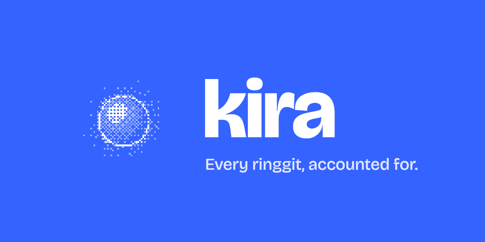

<p align="center">
  
</p>

kira is a free expense tracker for your phone that works without signal, syncs across your devices, and makes splitting a bill with friends painless. Log spending in a few taps, let rent and salary post themselves, and send a clean receipt to the group chat.

Install it as an app on Android or add it to your home screen from the browser. Sign in with Google and your data follows you to any device.

## What you can do

- **Log in seconds.** A TNG-style amount pad, a searchable category picker and a quick-add button within thumb reach.
- **See where it goes.** Monthly income, expense and net, spending by category and a six-month trend.
- **Automate the repeats.** Rent, salary, subscriptions and installments post on their own, even if you were offline when they came due.
- **Split a bill without the maths.** Itemized or even splits, service charge and SST handled, with shares that add up to the sen. Your own share is logged as an expense.
- **Send a receipt.** Turn a split into an image with your TNG QR on it and share it to WhatsApp. People you split with don't need an account to view it.
- **Split with friends and groups.** Add friends, make groups, track who owes whom and settle up with suggested payments.
- **Work offline.** Everything is instant and queues up while you have no signal, then syncs when you reconnect.
- **Keep it private.** Your data lives under your account only. There's an optional biometric or PIN app lock, and you can export a full backup any time.

## Who it's for

- **Anyone who wants a simple, honest record of their money** without ads, bank logins or a subscription.
- **Friends, housemates and colleagues who split bills** at restaurants, on trips and for shared rent, especially in Malaysia (ringgit, TNG and SST are built in).
- **People who want it to work on a bad connection**: on the LRT, in a basement car park or abroad.

kira is a personal tracker, not a budgeting suite. It is MYR-only for now and doesn't connect to your bank.

## Project docs

- Product spec: [SPEC.md](SPEC.md)
- Build plan: [PLAN.md](PLAN.md)
- Rules for contributors and agents: [CLAUDE.md](CLAUDE.md)

Built with Vite, React, TypeScript, Tailwind and Firebase on the free Spark plan, so it costs nothing to run.

## Run locally

```sh
cp .env.example .env   # fill in from Firebase console → Project settings → Your apps
npm install
npm run dev
```

## End-to-end tests

```sh
npx playwright install chromium   # once
npm run e2e                        # all scenarios, phone and desktop
npx playwright test -g "settle up" --project=desktop   # one scenario
```

Real user flows (sign in, transactions, friends, groups, invites, settle up, auto-log) run in Playwright, each person
in their own browser profile, against the local Firebase emulators. The emulators and a test copy of the app (port 5199) start
by themselves; Java 21+ is needed for the Firestore emulator. CI runs the same suite on every PR (`e2e.yml`).

- **Never live data.** The tests use the `demo-kira` project, which the emulators can't connect to anything real,
  and every test browser blocks the live Firebase hosts. The run refuses to start if port 5199 isn't the e2e build.
- **Sign-in** goes through the Auth emulator's REST API instead of the Google popup (the emulator's popup loads
  Google scripts from the internet and is flaky).
- **Known bugs** are tests marked `test.fail('#issue')`. When a fix lands, Playwright reports "expected to fail,
  but passed": remove the marker. A race that only fails sometimes is `test.fixme()` with a note instead. A test also fails on any Firestore permission error in the console, except
  where `knownFirestoreErrors('#issue')` allows it.
- A failure attaches each person's screenshot and console.

## Deploy

| Event | What CI does |
|---|---|
| Pull request | Lint, check scripts and build (`checks.yml`), then a preview URL that expires after 1 hour (re-run the workflow for a fresh one) (`preview.yml`). |
| Merge into `main` | The same checks, then deploys the live site (`deploy.yml`). The PWA updates itself on the next launch. |
| Merge that bumps `version` in `package.json` | Also builds a signed APK and publishes it as release `vX.Y.Z` (`deploy.yml`). |

`main` only accepts PRs whose checks pass. `firestore.rules` is not deployed by CI; after changing it, run `firebase deploy --only firestore:rules`.

## Releasing

The web app ships on every merge. The Android app ships only when the version changes, and `package.json` is the one place that version lives.

1. Branch `chores/release-X.Y.Z` off `main`.
2. Set `"version"` in `package.json` to the new version ([semver](https://semver.org)): patch for fixes, minor for features, major only for something that breaks older installs. Minor and patch stay between 0 and 99, because Android's `versionCode` is `major*10000 + minor*100 + patch`.
3. For an urgent fix (security, data loss) that older installs must not keep running, also raise `"minVersion"` to the new version. The app blocks anything below `minVersion` until it is updated.
4. Add the version's entry at the top of `src/lib/changelog.ts`: what people can now do, in plain words (no technical terms). It shows once after the update, and stays in Settings → What's new.
5. Open a PR and merge it. CI tags `vX.Y.Z`, builds and signs the APK, and publishes the release, with notes generated from the merged PRs.

The version must be higher than the latest release, or the release job fails. Don't push `v*` tags by hand.

**Old app versions keep running.** An installed APK is a snapshot that reads and writes the same Firestore data as the latest web app. Data changes must be additive: add fields, but never rename or remove them or change what an existing one means. Never tighten `firestore.rules` in a way that rejects writes from an older version.

## Dev build

"kira dev" is a second Android app (`app.kira.dev`) that installs next to the live one and uses the same data, for trying a branch on a phone before it ships. It checks for no updates and says "kira dev" in Settings.

1. `main` is live; `dev` is for trying things on a phone. Merge the feature branch into `dev` (or open a PR into `dev`): every push to `dev` builds the dev APK. Keep `dev` current by merging `main` into it. Another branch can be built by hand: Actions -> **Dev APK** -> Run workflow.
2. When it finishes, open the newest release on the [Releases page](../../releases) named `dev-N-sha` (signed in to GitHub on the phone) and download its APK. It is a draft, so only people with write access to the repo can see or download it.
3. Install it on the phone. Install a newer dev APK over the old one; same signing key, so the sign-in stays.

Drafts and pre-releases are never `latest`, so the live app never offers a dev build as an update.

## Install on Android

Releases are sideloaded from GitHub only (no Play Store):

1. Open the latest release on the [Releases page](../../releases) and download `kira-vX.Y.Z.apk`.
2. Open it on the phone and allow "Install unknown apps" for the browser or file manager when asked.
3. To update, install the newer APK over the old one (same signing key, so your data stays).
